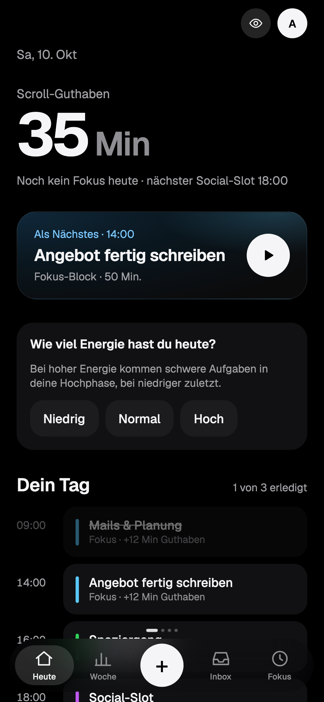
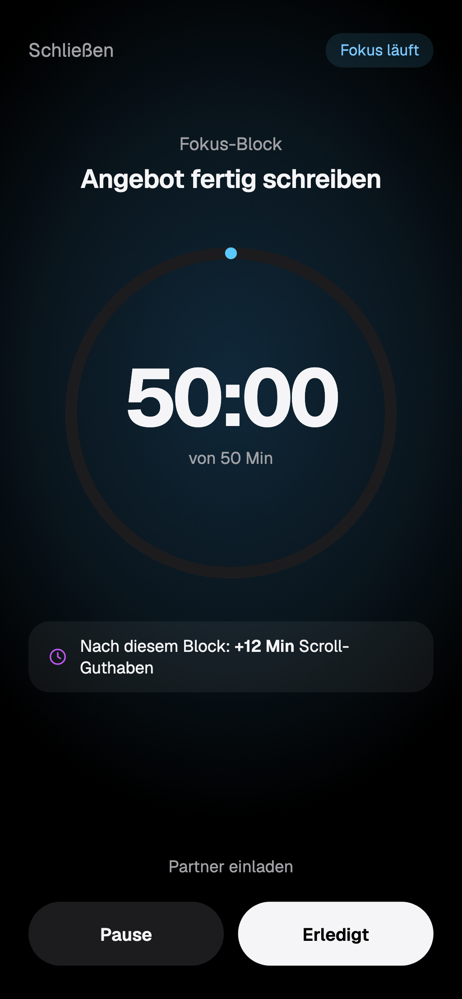
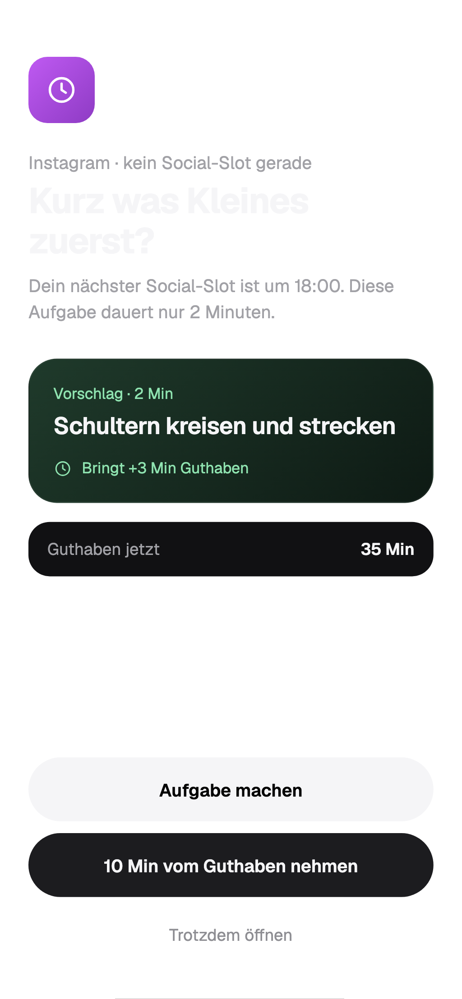
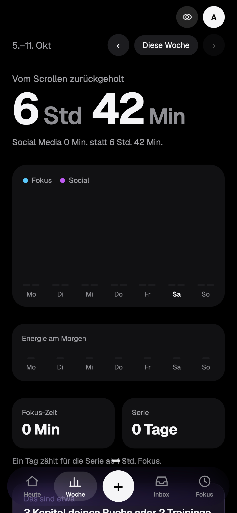

# FOKUS

Tagesplaner, der Social Media nicht verbietet, sondern einplant: **Produktive Zeit verdient Scroll-Zeit.** FOKUS plant Arbeit, Pausen und bewusste Social-Slots. Wer zur falschen Zeit scrollen will, bekommt eine kleine Aufgabe als Alternative statt einer Sperre. Als Web-App aufs iPhone installierbar, ohne Tracking und ohne Werbung.

- Entwicklung: [CLAUDE.md](CLAUDE.md)
- Betrieb (nur Betreiber): [docs/betrieb.md](docs/betrieb.md)
- Änderungen: [CHANGELOG.md](CHANGELOG.md)
- Design-Entwürfe: [design/](design) (im Browser öffnen)

| Heute                                     | Fokus-Modus                                           | Umleiten                                        | Woche                                     |
| ----------------------------------------- | ----------------------------------------------------- | ----------------------------------------------- | ----------------------------------------- |
|  |  |  |  |

Alle Seiten hell und dunkel: [docs/screenshots](docs/screenshots) (erzeugt mit `SHOTS=1 pnpm e2e screenshots` nach dem Web-Build, nur Beispieldaten).
